<picture>
  <source media="(prefers-color-scheme: dark)" srcset="assets/banner-dark.svg">
  
</picture>

 

I make small, sharp tools I use every day: side panels and meters for coding agents, zsh pickers for the terminal, and native iOS apps that keep your data yours.

 

### Building

<table>
<tr>
<td width="50%" valign="top">

**Agents**

[advisor-live](https://github.com/iskerwin/advisor-live) — live side pane of the advisor's calls and latency in Claude Code 
[agents-usage](https://github.com/iskerwin/agents-usage) — menu bar quota, cost and running tasks for Claude Code, Codex & Grok 
[agents-meter](https://github.com/iskerwin/agents-meter) — the Python library behind it 
[rex-agents](https://github.com/iskerwin/rex-agents) — the same, as a Rex side panel

</td>
<td width="50%" valign="top">

**Apps**

[Ledger X](https://github.com/iskerwin/ledger-x) — native SwiftUI client for Beancount, multi-currency, sync to storage you own 
[Lossless](https://github.com/iskerwin/LosslessPlayer) — offline lossless music player for iOS

</td>
</tr>
<tr>
<td width="50%" valign="top">

**Terminal**

[zsh-remote](https://github.com/iskerwin/zsh-remote) — SSH, SFTP, Telnet & FTP hosts in fzf pickers 
[zsh-ui](https://github.com/iskerwin/zsh-ui) — one look for all your zsh tools 
[command-finder](https://github.com/iskerwin/command-finder) — fzf picker for your own aliases and functions 
[tinge](https://github.com/iskerwin/tinge) — regex highlighting for network device consoles

</td>
<td width="50%" valign="top">

**Stack**

</td>
</tr>
</table>

### Activity

<picture>
  <source media="(prefers-color-scheme: dark)" srcset="https://github-readme-stats.vercel.app/api?username=iskerwin&show_icons=true&hide_border=true&hide_title=true&include_all_commits=true&bg_color=0d1117&text_color=9aa4af&icon_color=7ee787&ring_color=7ee787&title_color=e6edf3">
  
</picture>
<picture>
  <source media="(prefers-color-scheme: dark)" srcset="https://github-readme-stats.vercel.app/api/top-langs/?username=iskerwin&layout=compact&hide_border=true&hide_title=true&langs_count=6&bg_color=0d1117&text_color=9aa4af&title_color=e6edf3">
  
</picture>

<picture>
  <source media="(prefers-color-scheme: dark)" srcset="https://raw.githubusercontent.com/iskerwin/iskerwin/output/snake-dark.svg">
  
</picture>
